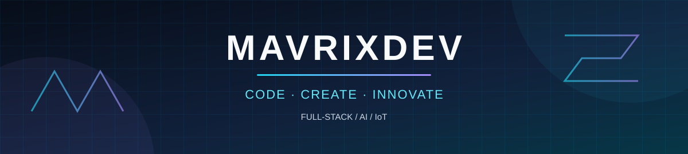

<!-- MAVRIXDEV • Personal GitHub Profile -->
<div align="center">




**Developer • Builder • Technology Explorer**

Based in Vietnam 🇻🇳 · Building practical digital products

[](https://github.com/Mavrixdev)


</div>

---

## 👨‍💻 About Me

```typescript
const mau = {
  name: "Mậu",
  brand: "Mavrixdev",
  location: "Vietnam 🇻🇳",
  focus: ["Full-stack Development", "AI Applications", "IoT & Embedded"],
  interests: [
    "Web Platforms",
    "Automation",
    "ESP32 / ESP8266",
    "Developer Tools",
  ],
  approach: "Learn by building real products",
  openTo: ["Creative collaboration", "Interesting tech projects"],
  motto: "Build it. Test it. Improve it.",
};
```

I enjoy turning ideas into usable solutions — from modern websites and backend services to AI-assisted tools and electronics experiments. I explore new technologies by designing, building, testing and improving real projects.

## 🧰 Tech & Tools

**Languages**


**Web & Backend**


**Hardware, OS & Workflow**


> These technologies reflect areas I work with or explore; they are not a claim of expert proficiency in every tool.

## 🚀 What I'm Building & Exploring

| Area                       | What interests me                                         |
| -------------------------- | --------------------------------------------------------- |
| 🌐 **Web Applications**    | Full-stack websites, e-commerce platforms and dashboards  |
| 🤖 **AI & Automation**     | Practical AI-powered tools, integrations and workflows    |
| 🔌 **IoT & Embedded**      | ESP32/ESP8266 experiments, displays and device interfaces |
| 🛠️ **Product Engineering** | Turning prototypes into useful, maintainable products     |

<!-- Replace the table above with links to your public repositories when ready. -->

## 📊 GitHub Activity

<div align="center">


<br/>


</div>

## 🐍 Contribution Journey

<div align="center">
  <picture>
    <source media="(prefers-color-scheme: dark)" srcset="https://raw.githubusercontent.com/Mavrixdev/Mavrixdev/output/github-snake-dark.svg" />
    <source media="(prefers-color-scheme: light)" srcset="https://raw.githubusercontent.com/Mavrixdev/Mavrixdev/output/github-snake.svg" />
    
  </picture>
</div>

## 🌐 Connect with Me

<div align="center">

[](https://t.me/Mavrixdev)
[](https://zalo.me/0935877156)
[](https://www.facebook.com/ntmdz08)
[](https://github.com/Mavrixdev)

<br/>

**Have an interesting idea, project collaboration, or just want to chat tech? Let's connect!**

<br/>


</div>
